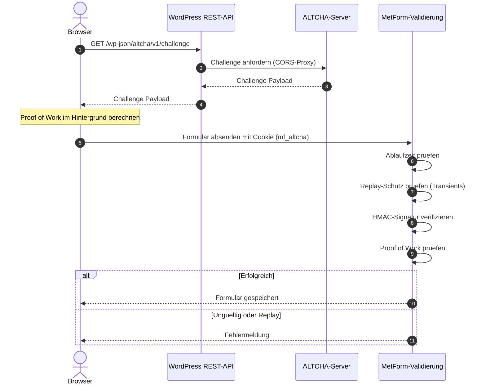

# ALTCHA for MetForm

[](https://wordpress.org)
[](https://www.php.net)
[](LICENSE)
[](https://altcha.org)

DSGVO-konforme, cookielose Spam-Schutz-Integration für MetForm-Formulare in WordPress auf Basis von ALTCHA (Proof-of-Work).


## Problemstellung & Lösung

Klassische CAPTCHA-Lösungen wie Google reCAPTCHA übertragen personenbezogene Daten in Drittstaaten und erfordern oft störende Interaktionen (z. B. Bilderrätsel).

Dieses Plugin integriert das quelloffene ALTCHA-System direkt in den Validierungszyklus von MetForm:
- **DSGVO-konform:** Keine Cookies zur Nachverfolgung, kein Datentransfer an Werbenetzwerke.
- **Proof-of-Work:** Der Client löst im Hintergrund eine kryptografische Challenge, ohne dass die Benutzererfahrung beeinträchtigt wird.
- **Nahtlose Integration:** Klinkt sich in MetForms nativen Validierungsfilter (`mf_after_validation_check`) ein.


## Architektur & Ablauf




## Kernfunktionen

- **REST-API Challenge Proxy (`altcha/v1/challenge`):** Verhindert CORS-Konflikte, indem WordPress die Challenge direkt an den Browser ausliefert.
- **Replay Protection:** Bereits eingereichte Challenges werden temporär via WordPress Transients (`altcha_<hash>`) gespeichert und für Folgeanfragen blockiert.
- **HMAC- & PoW-Validierung:** Serverseitige Verifizierung der Signatur mittels `hash_equals()` zum Schutz vor Timing-Attacken.
- **MetForm-Kompatibilität:** Nutzt den internen Filter `mf_after_validation_check`, sodass Fehlermeldungen direkt im Frontend-Formular gerendert werden.


## Installation & Einrichtung

1. Ordner `altcha-metform` in das Verzeichnis `wp-content/plugins/` kopieren.
2. In der Datei `wp-config.php` den geheimen HMAC-Schlüssel definieren:
   ```php
   define('ALTCHA_HMAC_KEY', 'dein-geheimer-hmac-key');
   ```
3. Plugin im WordPress-Adminbereich unter **Plugins** aktivieren.
4. Die Proxy-URL bei Bedarf in `altcha-metform.php` anpassen (`$altcha_server`).


## Tech Stack

- **PHP 7.4+ / 8.0+** (Hash HMAC, Transients API, REST API)
- **WordPress Plugin API** (Hooks & Filters)
- **MetForm Plugin API**
- **Vanilla JavaScript** (Web Component & State Listener)


## Lizenz

Lizenziert unter der [MIT-Lizenz](LICENSE).
